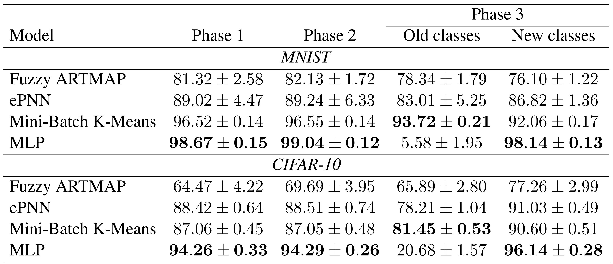

*Link to the paper is coming soon!*

## Abstract

Lifelong learning requires models to acquire new knowledge while retaining previously learned information without unbounded computational and
memory requirements. This work investigates whether local parameter updates, properties of Fuzzy ARTMAP, evolving Probabilistic Neural Networks,
and class-wise Mini-Batch K-Means, improve resilience to catastrophic forgetting. The methods are evaluated against a multilayer perceptron in a classincremental protocol on MNIST and CIFAR-10. Results show that all three incremental methods preserve knowledge better than the baseline. The classifier
based on Mini-Batch K-Means achieved the best performance and resistance
to forgetting, while ePNN provided an accuracy-memory trade-off. These results indicate that local updates and modularity can improve lifelong learning.
Code is available at [https://github.com/lsalatiel/art-epnn_neural-network-study](https://github.com/lsalatiel/art-epnn_neural-network-study).

